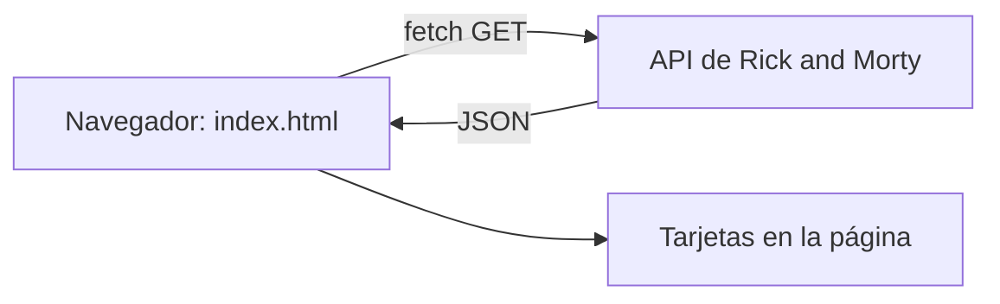

App de rick and morty characters

la app funciona a base de la api que proporciona los personajes y te los muestra en frenchs

como se usa?
abrir el .html en el navegador.

Api usada:
https://rickandmortyapi.com/api/character

que se uso:
HTML
CSS
JavaScript (fetch, async)

Diagrama de bloques:

